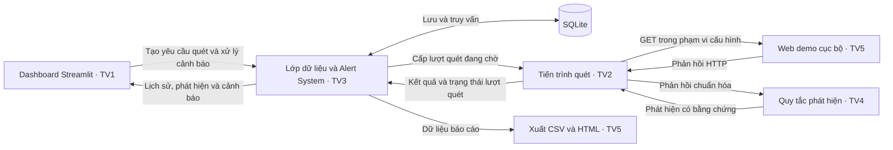

# Tuần 1 — Thiết kế dashboard và điều phối nhóm

**Đề tài** · Automated Web Security Scanner with Dashboard + Alert System

**Phụ trách** · Thành viên 1, trưởng nhóm và dashboard Streamlit

Kế hoạch triển khai theo [bảng phân công 6 tuần](PHAN_CONG.md). Trong phạm vi demo, Alert System tạo cảnh báo từ phát hiện của bộ quét. Nhóm dùng ứng dụng web cục bộ do nhóm kiểm soát và chọn mục tiêu đã cấu hình.

## Mốc bàn giao

| Tuần | Mục tiêu và tiêu chí nghiệm thu |
|---|---|
| **1** | Chốt sơ đồ tích hợp, bố cục dashboard, các trường dữ liệu và kịch bản demo. |
| **2** | Dashboard hiển thị được lịch sử quét, phát hiện và cảnh báo mẫu. Bộ lọc chạy được với lượt quét sạch và lượt quét có lỗi. |
| **3** | Một lượt quét web demo tạo phát hiện có bằng chứng. SQLite lưu kết quả và Alert System tự tạo cảnh báo khi đạt ngưỡng. Dashboard đọc được dữ liệu thật. |
| **4** | Worker tiếp tục xử lý khi tắt Streamlit. Khi mở lại, xem được kết quả, xử lý cảnh báo và xuất báo cáo. |
| **5** | Kiểm tra các luồng chính trên Windows và Linux, gồm timeout, URL ngoài phạm vi và lưu lại kết quả trùng. |
| **6** | Chạy demo từ bản cài mới theo README và đối chiếu dữ liệu dashboard với báo cáo. |

## Kiến trúc tích hợp



Worker chạy riêng để lượt quét tiếp tục khi dashboard dừng. Bộ quy tắc trả phát hiện cho worker, rồi Alert System áp dụng ngưỡng cấu hình để tạo cảnh báo. Dashboard đọc kết quả qua lớp dữ liệu. Tuần 2 thay lớp dữ liệu bằng [tệp mẫu](dashboard/sample_data.json) để kiểm tra giao diện trước khi tích hợp.

## Phác thảo dashboard

```text
Web Security Scanner Dashboard
────────────────────────────────────────────────────────────
Khoảng ngày [Từ – Đến]   Mục tiêu [Tất cả]   Mức độ [Tất cả]

[Lượt quét]  [Trang đã thử]  [Phát hiện]  [Cảnh báo]

[Lượt quét]    [Phát hiện]    [Cảnh báo]
────────────────────────────────────────────────────────────
Lượt quét      Mã lượt · Mục tiêu · Thời điểm · Trạng thái
Phát hiện      URL · Quy tắc · Mức độ · Bằng chứng · Khắc phục
Cảnh báo       Mã cảnh báo · Phát hiện liên quan · Trạng thái
```

- **Tổng quan** đặt bốn chỉ số ở đầu trang. Khoảng ngày được tính theo ngày tạo lượt quét tại Việt Nam. Bộ lọc mức độ áp dụng cho phát hiện và cảnh báo.
- **Lượt quét** hiển thị mục tiêu, thời điểm, số trang đã thử và lỗi rút gọn nếu có.
- **Phát hiện** hiển thị URL, mã quy tắc, mức độ, bằng chứng rút gọn và hướng khắc phục.
- **Cảnh báo** liên kết về phát hiện tương ứng. Tuần 4 thêm thao tác xác nhận đã xem, đánh dấu đã xử lý và xem lịch sử.

## Dữ liệu dùng chung

| Đối tượng | Trường tối thiểu | Đầu mối |
|---|---|---|
| Lượt quét | `scan_id`, `target`, `created_at`, `finished_at`, `status`, `pages_attempted`, `error` | Thành viên 2 và 3 |
| Phát hiện | `finding_id`, `scan_id`, `url`, `rule_id`, `severity`, `evidence`, `recommendation` | Thành viên 4 và 3 |
| Cảnh báo | `alert_id`, `finding_id`, `created_at`, `severity`, `status` | Thành viên 3 |
| Báo cáo | Thời điểm, mục tiêu, URL, quy tắc, mức độ, bằng chứng, cách khắc phục và trạng thái cảnh báo nếu có | Thành viên 5 |

Lưu thời gian ở UTC và hiển thị giờ Việt Nam. Lượt quét hoàn tất có thể có 0 phát hiện. Trạng thái `partial` cho biết một số trang đã cho kết quả và một số trang gặp lỗi. Cảnh báo có vòng đời `open` → `acknowledged` → `resolved`.

## Điểm cần chốt trước tích hợp

- Thành viên 2 và 4 thống nhất định dạng phản hồi HTTP, quy tắc áp dụng và cách rút gọn bằng chứng.
- Thành viên 3 cung cấp cách đọc lịch sử, tìm theo mục tiêu và lấy phát hiện liên quan đến cảnh báo.
- Thành viên 5 đối chiếu cột báo cáo và chốt các ca demo gồm trang cấu hình đúng, trang thiếu cấu hình và lỗi kết nối.
- Thành viên 1 xác nhận dữ liệu cho giao diện và điều phối nghiệm thu từng tuần.
